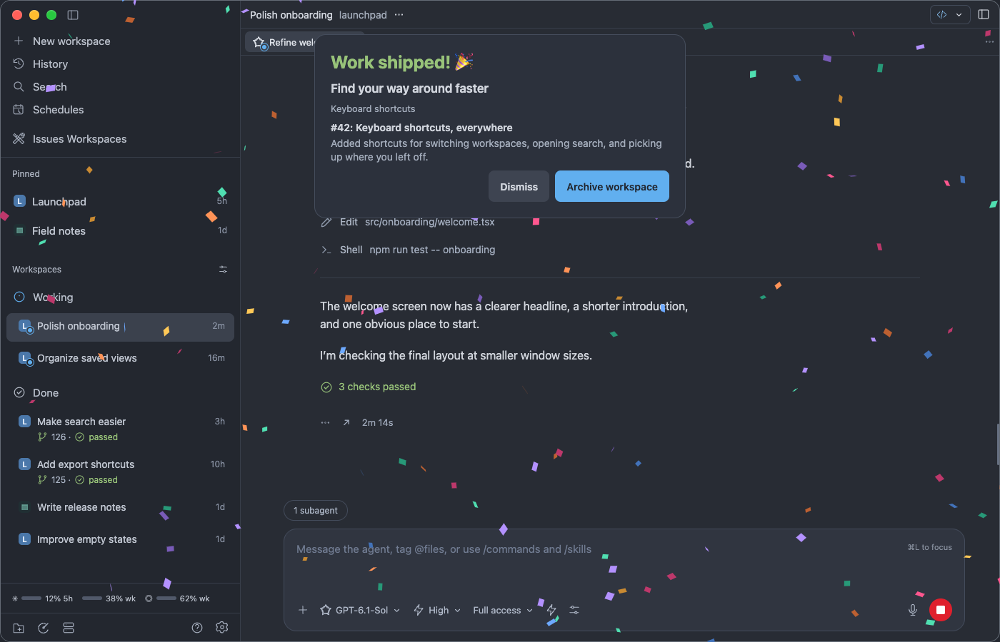

# Paseo merge celebration 🎉

**You shipped it. Enjoy the moment.**

A little celebration for a lot of hard work. When your pull request is merged, colorful confetti falls across Paseo, with a recap of what you just shipped.

_Staged screenshot: the real celebration UI over a fictional workspace._

## A proper send-off for finished work

- **Celebrate automatically.** Merge your PR and let the confetti fly.
- **Remember the win.** See the PR title and a short recap of linked issues.
- **Keep your flow.** Your current screen stays right where it is, ready to use.
- **Enjoy it as long as you like.** Hit **Dismiss** to keep working, or **Archive workspace** to put the workspace away. The last pieces drift offscreen.
- **Keep it calm.** Reduced motion gives you the recap without the animation.
- **Make it yours.** Pick the words, the emoji and the kind of confetti you like.

Unmerged work stays quiet. Existing merged PRs at plugin startup do not trigger celebrations. Merge detection follows Paseo’s GitHub status refreshes. Disable Paseo’s automatic workspace archival after merge if you want to choose when to archive from the celebration. Missed celebrations wait for your desktop or browser to reconnect, for up to 24 hours. Once a window shows one, it will not replay on reconnect. Pending events are held in memory and clear when the plugin or daemon restarts.

## Make it yours

Open **Settings → Plugins → Merge celebration**, or choose **Merge celebration settings** in the Command Center.

| Setting | Choices |
| --- | --- |
| **Celebrate merged work** | On or off. Preview still works when it’s off. |
| **Verb** | Work _shipped_, _landed_, _merged_, _committed_ or _deployed_ |
| **Emoji** | 🎉, 🚀, ✨, 🥳 or none |
| **Show linked issues** | Include or hide the recap of the issues your PR closes |
| **Show confetti** | Keep the recap and skip the confetti |
| **Size** | Small, medium or large pieces |
| **Speed** | A slow drift, a normal fall or a fast flurry |
| **Amount** | Light, normal or heavy |

Changes apply right away, even to confetti that’s already falling. Press **Preview** on the settings page to try them. Your choices are saved on the Paseo host, so every window connected to that host gets the same celebration.

## Try a little joy

Open the Command Center with **⌘K** (or **Ctrl+K**) and choose **Preview merge celebration**. No merge needed. Archive workspace is disabled in previews.

Supports **Paseo 0.11.2 through 0.12.x on desktop and in the browser**, with GitHub pull requests.

[Setup and development →](DEVELOPMENT.md)
